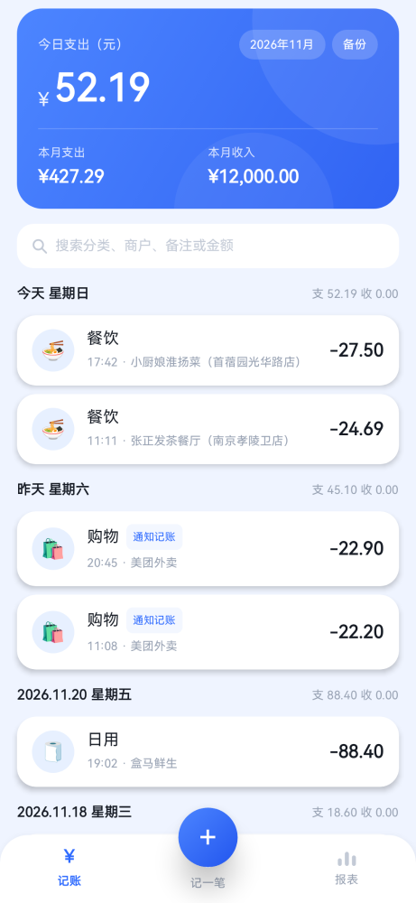

# AI 记账

一个自用的 Android 记账 App：手动记账 + 自动捕捉（规划中），数据全部留在本机。

当前进度：**v0.1 骨架完成**，手动记账闭环可用（记一笔 → 列表 → 月度报表），自动捕捉与账单导入尚未开始。
范围与排期见 [docs/mvp-scope.md](docs/mvp-scope.md)。

## 界面

| 记账首页 | 报表 | 记一笔 |
| --- | --- | --- |
|  |  |  |

空状态：


> 以上截图由 Paparazzi 在 JVM 上用 layoutlib 真实渲染，不是设计稿。

## 技术栈

- Kotlin 2.0.21 + Jetpack Compose（Material 3，自建蓝白主题）
- Room 2.6.1（KSP）+ 协程 Flow，本地 SQLite，无后端、无账号
- 单 Activity + Compose 状态驱动，无第三方图表库（趋势图用 Canvas 画）
- 测试：JUnit4（领域逻辑）+ Paparazzi（界面快照）

## 构建与运行

前置：JDK 17、Android SDK（platform 34 + build-tools 34.0.0）。

```bash
# 1. 指向本机 SDK
echo "sdk.dir=D:\\tools\\android-sdk" > local.properties   # 改成你的路径

# 2. 编译
./gradlew assembleDebug        # 产物 app/build/outputs/apk/debug/app-debug.apk

# 3. 测试（34 个单元测试 + 4 个界面快照）
./gradlew testDebugUnitTest

# 4. 交互测试（需要真机或模拟器）
./gradlew connectedDebugAndroidTest

# 5. 重新生成界面截图（会更新 app/src/test/snapshots 与 docs 用的图）
./gradlew recordPaparazziDebug
```

想在电脑上跑起来，可以建一个模拟器：

```bash
sdkmanager "emulator" "system-images;android-34;google_apis;x86_64" \
           "extras;google;Android_Emulator_Hypervisor_Driver"
avdmanager create avd -n aiacc -k "system-images;android-34;google_apis;x86_64" -d pixel_5
emulator -avd aiacc
adb install -r app/build/outputs/apk/debug/app-debug.apk
```

Windows 上要先装加速驱动（`silent_install.bat`，管理员权限），否则 x86 模拟器起不来。

## 目录结构

```
app/src/main/java/com/aiaccounting/
├── core/           金额(分)格式化、日期文案
├── domain/         纯逻辑：金额输入状态机、去重指纹、按天分组、报表聚合
├── data/           Room 实体/DAO/数据库、仓库、种子分类
├── ui/
│   ├── theme/      颜色与排版
│   ├── components/ 卡片、胶囊、底部导航、趋势柱状图
│   ├── home/       首页：渐变头卡 + 按日流水
│   ├── entry/      记一笔：自建键盘 + 分类宫格 + 表达式（12+8）
│   └── report/     报表：周/月/年 + 趋势 + 分类占比
└── AccountingApp / MainActivity
```

## 已经能做什么

- 手动记一笔：支出/收入、10 个支出分类、4 个账户、备注、日期与金额（支持 `12+8` 这类表达式）
- 首页按天分组展示流水，显示今日支出、本月支出、本月收入
- 报表支持周/月/年切换与前后翻页，含支出趋势、分类占比、与上期比较
- 三路来源的数据模型已经预留：`TransactionEntity` 有 `source`（手动/通知/导入）、`dedupKey`、`status`，`AccountingRepository.addCapturedTransaction()` 已实现「同指纹不重复入库」

## 下一步

1. 通知监听 spike（微信/支付宝），实测真实命中率——见 MVP 文档 5.1，这是排期关键
2. 待确认收件箱（PENDING 记录的一键确认）
3. 支付宝/微信账单文件导入 + 对账合并
4. 导出备份（CSV / JSON）

## 开发约定

见 [AGENTS.md](AGENTS.md)：每次改动都要有对应的 commit，并在交付前保证测试通过。
